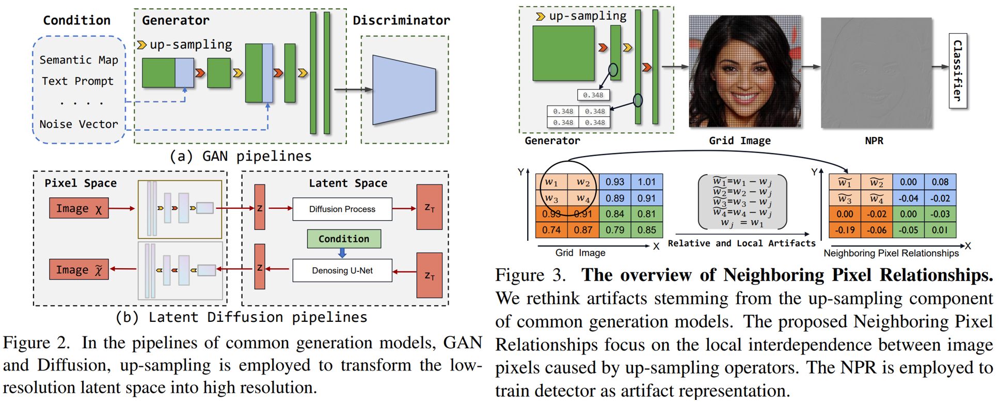

# Deepfake Detection: Baseline vs NPR vs Hybrid

A controlled comparison of three CNN detectors for AI-generated images (a plain RGB ResNet-50 baseline, the CVPR'24 NPR detector, and a spatial-frequency hybrid) with a full training, evaluation and reporting pipeline.


<p align="center">
  
  <br>
  <em>Overview figure from the original NPR paper (Tan et al., CVPR 2024).</em>
</p>

This repository is part of a scientific research project on deepfake detection with CNNs, evaluated with **Accuracy, AUC and False Positive Rate (FPR)** plus AP, precision, recall and F1. It is built on the official code of
[*Rethinking the Up-Sampling Operations in CNN-based Generative Network for Generalizable Deepfake Detection*](https://arxiv.org/abs/2312.10461) (CVPR 2024), and provides the **baseline and hybrid models** used to put the NPR detector in context. The NPR-focused extensions (AdaptiveNPR, Gradio demo, Docker) live in [`Deepfake-Detect`](https://github.com/KimThanhTran/Deepfake-Detect).

## 📌 Overview

All three models are selected with one flag, `--model_type {baseline, npr, hybrid}` (`networks/__init__.py`):

| `--model_type` | Model | Description |
|---|---|---|
| `baseline` | RGB ResNet-50 | torchvision ResNet-50 (randomly initialized, `weights=None`) with a 1-logit head, fed with the plain RGB image |
| `npr` | NPR | The original NPR detector (`networks/resnet.py`), which classifies the neighboring-pixel residual |
| `hybrid` | HSF (Hybrid Spatial-Frequency) | ResNet-50 spatial branch (512-d) + CNN over the FFT log-magnitude spectrum (256-d), concatenated and classified by an MLP with dropout |

### What this repository adds to the original code

- Model factory and `--model_type` option in `train.py`, `test.py` and the evaluators.
- Training loop with per-epoch validation loss / accuracy / AP / AUC, best-checkpoint saving (by validation AP), early stopping, resumable training (`--continue_train`, `--no_timestamp`) and TensorBoard logging.
- `experiment_pipeline.py`: one script that trains, optionally fine-tunes, runs inference, evaluates and compares the models, with a resumable state file.
- Benchmark evaluation (`evaluate_benchmarks.py`): Accuracy, precision, recall, F1, AP, ROC-AUC, real/fake accuracy and confusion-matrix counts per subset, plus **Grad-CAM overlays** for sample images, saved to `predictions.csv`, `summary.csv/json` and an `xai/` folder.
- `generate_html_report.py`: turns a `summary.csv` into an HTML benchmark report.
- Kaggle notebooks for the baseline, hybrid and hybrid fine-tuning runs.

## 📊 Results

All values are taken from files in this repository. FPR is derived from the stored confusion matrix as `FP / (FP + TN)`.

### 1. Validation during training (ForenSynths `val`, 10 epochs)

Source: `paper_baseline_10ep*/log.log` and `paper_hybrid_10ep/log.log` (Kaggle runs; `opt.txt` records the settings: Adam, lr 1e-4, 10 epochs, no augmentation; batch size 64 for the baseline and 16 for the hybrid). The "best" checkpoint is the one with the highest validation AP.

| Model | Best epoch | Val Acc | Val AP | Val AUC | Last epoch (10) Acc / AP / AUC |
|---|---:|---:|---:|---:|---|
| Baseline RGB ResNet-50 | 9 | 91.63% | 99.08% | 99.06% | 72.94% / 90.54% / 90.20% |
| Hybrid (HSF) | 9 | 89.62% | 98.17% | 98.24% | 91.69% / 97.30% / 97.32% |

The hybrid starts much higher (epoch 1 val accuracy 81.31% vs 52.62% for the baseline), while the baseline needs several epochs to start learning; both fluctuate noticeably between epochs. One epoch took about 2,540 s for the baseline and 3,180 s for the hybrid in these logs.

### 2. Test results of the baseline model

Source: `outputs_baseline_eval/benchmark_eval_20260410_153954/summary.csv` (checkpoint `paper_baseline_10ep.../model_epoch_best.pth`, threshold 0.5).

| ForenSynths test subset | Samples | Accuracy | AP | ROC-AUC | FPR |
|---|---:|---:|---:|---:|---:|
| ProGAN | 8,000 | 90.75% | 97.11% | 96.87% | 10.82% |
| StyleGAN | 11,982 | 72.83% | 82.88% | 80.93% | 11.62% |
| StarGAN | 3,998 | 68.21% | 74.56% | 74.45% | 21.31% |
| CycleGAN | 2,642 | 66.84% | 70.84% | 72.85% | 39.82% |
| GauGAN | 10,000 | 60.05% | 57.94% | 62.94% | 48.00% |
| BigGAN | 4,000 | 52.78% | 51.75% | 54.68% | 40.10% |
| DeepFake | 5,405 | 51.77% | 53.71% | 53.48% | 54.86% |

Additional baseline results stored as single JSON files in `outputs_baseline_eval/`:

| Test set | Samples | Accuracy | AP | ROC-AUC | FPR | Source |
|---|---:|---:|---:|---:|---:|---|
| ForenSynths StyleGAN2 | 15,976 | 86.45% | 94.02% | 94.23% | 12.31% | `forensynths_stylegan2_baseline.json` |
| UniversalFakeDetect | 16,000 | 66.38% | 73.66% | 74.01% | 12.90% | `universalfakedetect_baseline.json` |
| GANGen-Detection | 36,000 | 57.14% | 58.49% | 60.21% | 35.20% | `gangen_baseline.json` |

**Takeaway:** the RGB baseline fits the training generator family (ProGAN) well but generalizes poorly to unseen generators (many subsets close to chance), which is the gap that NPR-style residual features and the frequency branch are meant to address. Test-set results for the hybrid model are **not** stored in this repository yet; run the evaluation below to produce them.

Grad-CAM overlays for a few real/fake samples per subset are in `outputs_baseline_eval/benchmark_eval_20260410_153954/<subset>/xai/`.

## 📁 Project structure

```
.
├── train.py                  # training (--model_type baseline | npr | hybrid)
├── test.py                   # evaluation of a checkpoint on the benchmark folders
├── evaluate_benchmarks.py    # full metrics + Grad-CAM per benchmark
├── evaluate_predictions.py   # metrics / figures from saved predictions
├── experiment_pipeline.py    # train -> fine-tune -> inference -> evaluate -> compare
├── generate_html_report.py   # HTML report from summary.csv
├── tools/eval_binary_benchmark.py
├── networks/                 # baseline_model.py, resnet.py (NPR), frequency_branch.py (hybrid), trainer.py
├── options/, data/           # CLI options, datasets and dataloaders
├── baseline-npr.ipynb, hybrid-hsf.ipynb, hybrid-finetune.ipynb   # Kaggle notebooks
├── paper_baseline_10ep*/, paper_hybrid_10ep/   # training logs, options and TensorBoard events
└── outputs_baseline_eval/    # baseline evaluation outputs (csv / json / Grad-CAM images)
```

## ⚙️ Installation

```bash
git clone https://github.com/KimThanhTran/Deepfake-Detect-baseline.git
cd Deepfake-Detect-baseline

python -m venv .venv
# Windows: .venv\Scripts\activate      Linux/macOS: source .venv/bin/activate
pip install -r requirements.txt
```

`requirements.txt` lists scipy, scikit-learn, numpy, matplotlib, seaborn, opencv-python, Pillow, torch and torchvision. Install a CUDA build of PyTorch from the [PyTorch index](https://pytorch.org/get-started/locally/) if you have a GPU (the hybrid model uses `torch.fft`, so use a recent PyTorch). TensorBoard is optional: logging falls back to a no-op if it is missing.

## 🚀 Usage

### Train

Expected layout: `<dataroot>/{train,val,test}` (see [Dataset notes](#-dataset-notes)). If `--classes` is empty, all class folders under the split are used.

```bash
# RGB ResNet-50 baseline
python train.py --model_type baseline --name paper_baseline_10ep \
    --dataroot ./dataset/ForenSynths --niter 10 --gpu_ids 0 --num_threads 4

# Hybrid spatial-frequency model
python train.py --model_type hybrid --name paper_hybrid_10ep --no_timestamp \
    --dataroot ./dataset/ForenSynths --niter 10 --gpu_ids 0 --num_threads 4 --batch_size 16

# NPR
python train.py --model_type npr --name npr_run --dataroot ./dataset/ForenSynths --niter 10
```

Continue / fine-tune a run (as in `hybrid-finetune.ipynb`):

```bash
python train.py --model_type hybrid --name paper_hybrid_10ep --no_timestamp --continue_train \
    --epoch latest --dataroot ./dataset/ForenSynths --niter 15 --batch_size 16 --lr 1e-5
```

Checkpoints go to `checkpoints/<name>/` (`model_epoch_best.pth`, `model_epoch_latest.pth`, `model_epoch_last.pth`). The Kaggle notebooks run the same commands.

### Evaluate

```bash
# Metrics + Grad-CAM for every benchmark folder under ./dataset
python evaluate_benchmarks.py --model_path checkpoints/<run>/model_epoch_best.pth \
    --model_type baseline --output_dir outputs --batch_size 32

# One benchmark root, JSON output
python tools/eval_binary_benchmark.py --root ./dataset/GANGen-Detection \
    --model_path checkpoints/<run>/model_epoch_best.pth --model_type baseline \
    --output_json outputs/gangen.json

# HTML report from a summary.csv
python generate_html_report.py --report_dir outputs/<benchmark_eval_run>
```

`evaluate_benchmarks.py` covers `ForenSynths` (test), `GANGen-Detection`, `DiffusionForensics`, `UniversalFakeDetect` and `Diffusion1kStep` (select with `--benchmark`). `test.py --model_path <ckpt> --model_type <type>` prints accuracy / AP per subset, but its dataset roots are hard-coded near the top of the file and must be edited for your machine.

### Full comparison pipeline

```bash
python experiment_pipeline.py --datasets_root ./dataset --models baseline hybrid hybrid_finetune \
    --train_epochs 10 --stages train finetune inference evaluate compare
```

Stages are resumable through `outputs/pipeline_state.json`; `--existing_checkpoint model=path` reuses trained checkpoints.

## 🗂 Dataset notes

Datasets are not included in the repository. `download_dataset.sh` (uses `gdown`) downloads the benchmark data referenced by the original NPR project.

```
dataset/
├── ForenSynths/{train,val,test}      # train/val: car, cat, chair, horse, each with 0_real / 1_fake
├── GANGen-Detection/
├── DiffusionForensics/
├── UniversalFakeDetect/
└── Diffusion1kStep/
```

Training and validation use ForenSynths (CNNDetection, Wang et al., CVPR 2020); the other sets are generalization benchmarks (links in the [original NPR repository](https://github.com/chuangchuangtan/NPR-DeepfakeDetection)). Evaluation folders use the `0_real` / `1_fake` convention.

## 🙏 Acknowledgements & Citation

This project builds on the official [NPR-DeepfakeDetection](https://github.com/chuangchuangtan/NPR-DeepfakeDetection) implementation by Chuangchuang Tan et al. (Beijing Jiaotong University, YanShan University, A*STAR), which in turn borrows partially from [CNNDetection](https://github.com/peterwang512/CNNDetection). If you use this work, please cite the NPR paper:

```bibtex
@inproceedings{tan2024rethinking,
  title     = {Rethinking the Up-Sampling Operations in CNN-based Generative Network for Generalizable Deepfake Detection},
  author    = {Tan, Chuangchuang and Liu, Huan and Zhao, Yao and Wei, Shikui and Gu, Guanghua and Liu, Ping and Wei, Yunchao},
  booktitle = {Proceedings of the IEEE/CVF Conference on Computer Vision and Pattern Recognition (CVPR)},
  year      = {2024},
  eprint    = {2312.10461},
  archivePrefix = {arXiv}
}
```

**Author:** Trần Thị Kim Thanh ([@KimThanhTran](https://github.com/KimThanhTran)), final-year Software Engineering student at HUTECH, as part of a scientific research project on deepfake detection.
